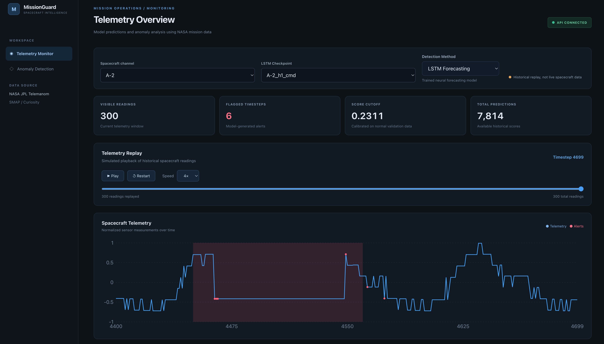
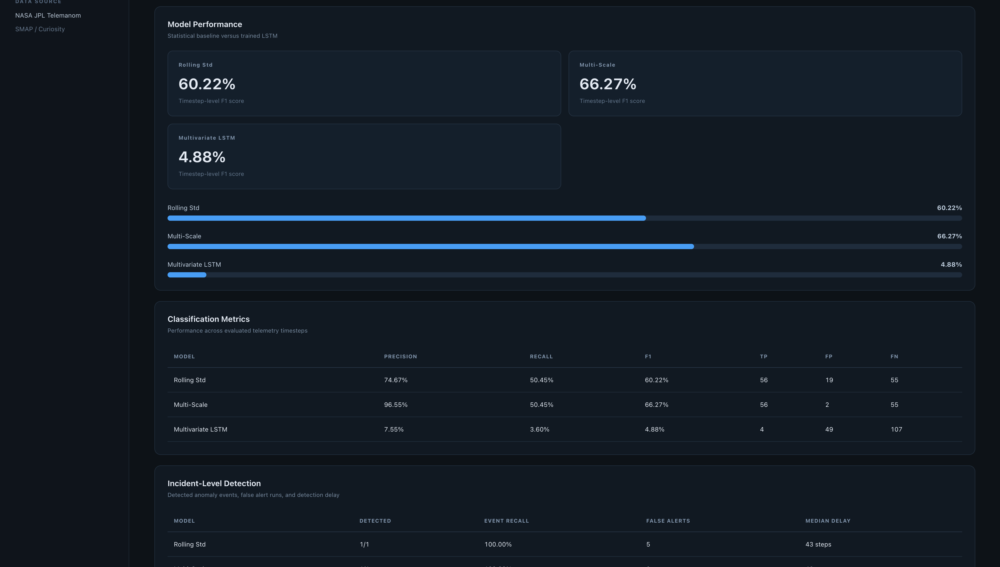

# MissionGuard
### NASA Spacecraft Telemetry Anomaly Detection

[](https://github.com/victorhuii/Spacecraft-Anomaly-Project/actions/workflows/ci.yml)

**[Live Dashboard](https://spacecraft-anomaly-project.pages.dev)** | **[API Documentation](https://spacecraft-anomaly-project.onrender.com/docs)**

MissionGuard is a full-stack machine learning research application for detecting and visualizing anomalies in historical NASA spacecraft telemetry. It combines statistical anomaly detection, PyTorch LSTM forecasting, a FastAPI backend, and an interactive React dashboard.

The project investigates a central challenge in spacecraft monitoring: distinguishing anomalous behavior from normal operational variation while minimizing false alarms.



## Features

- **Interactive Telemetry Monitoring:** Explore historical NASA SMAP satellite and Mars Curiosity rover telemetry.
- **Three Detection Methods:** Compare rolling standard deviation, multi-scale statistical detection, and LSTM forecasting.
- **Historical Replay:** Play, pause, restart, and navigate through spacecraft telemetry.
- **Ground-Truth Visualization:** Highlight NASA-annotated anomalous intervals alongside model predictions.
- **Model Analytics:** Compare precision, recall, F1, confusion-matrix counts, event detection, and false alert runs.
- **Model Inference API:** Access paginated historical predictions through FastAPI.
- **Automated Testing:** Python tests and GitHub Actions CI for backend validation and frontend builds.

The public demo supports four representative channels. The local research pipeline supports the broader NASA Telemanom dataset.

## Technology Stack

| Layer | Technologies |
|---|---|
| Machine Learning | Python, PyTorch, LSTM, NumPy, Pandas |
| Data Processing | Sliding windows, multivariate time series, chronological validation |
| Backend | FastAPI, REST APIs, Python caching |
| Frontend | React, TypeScript, Vite, Recharts |
| Testing | Pytest, FastAPI TestClient, GitHub Actions |
| Deployment | Cloudflare Pages, Render |
| Data | NASA JPL Telemanom, SMAP, MSL |

## System Architecture

```text
               NASA Telemanom Dataset
                    SMAP / MSL
                        |
                        v
              Data Processing Pipeline
              Normalization / Windows
                        |
             +----------+----------+
             |                     |
             v                     v
     Statistical Detectors    LSTM Forecasting
     - Rolling Std            - Univariate
     - Multi-Scale            - Command-Aware
             |                     |
             +----------+----------+
                        |
                        v
              Evaluation & Benchmarking
                        |
                        v
              Precomputed Demo Artifacts
                  JSON / GZIP
                        |
                        v
                 FastAPI Demo API
                   Render Hosting
                        |
                        v
               React + TypeScript
                Cloudflare Pages
                        |
                        v
                 MissionGuard UI
```

The full local research application performs model inference using PyTorch. The public demo instead serves precomputed historical predictions through a lightweight FastAPI deployment.

## Detection Methods

### 1. Rolling Standard Deviation

Measures variation in telemetry over a 30-timestep window. Unusually low variance is flagged as a potential anomaly.

This baseline is particularly useful for detecting sustained flatline behavior.

### 2. Multi-Scale Statistical Detection

Computes rolling standard deviation across windows of 15, 30, and 60 timesteps.

Each window independently votes for anomalous low-variance behavior. An anomaly is flagged when at least two detectors agree.

Thresholds are calibrated using normal training telemetry. Degenerate zero thresholds are explicitly disabled.

### 3. LSTM Forecasting

PyTorch LSTM models learn sequential telemetry patterns and predict future sensor values.

The project includes:
- Univariate sensor forecasting
- Multivariate forecasting incorporating spacecraft command features
- Forecast-error anomaly scoring
- Chronological training and validation

Experiments demonstrated that low forecasting error does not necessarily indicate normal behavior. Sustained anomalous signals can become predictable, causing LSTM-based detectors to miss them.

## Experimental Results

### Development Channel: A-2

| Detector | Precision | Recall | F1 |
|---|---:|---:|---:|
| Rolling Std | 74.67% | 50.45% | 60.22% |
| Multi-Scale | **96.55%** | 50.45% | **66.27%** |
| Command-Aware LSTM | 7.55% | 3.60% | 4.88% |

Multi-scale detection reduced false-positive timesteps from 19 to 2 on A-2 while preserving 56 true-positive detections.

These are exploratory development-channel results, not a measure of generalization.

### Held-Out Evaluation: 71 Channels

Detector configurations were frozen before evaluation on 71 previously unused labeled channels.

| Metric | Rolling Std | Multi-Scale |
|---|---:|---:|
| Micro Precision | 9.02% | 8.16% |
| Micro Recall | 8.96% | 7.77% |
| Micro F1 | **8.99%** | 7.96% |
| Macro F1 | **3.40%** | 2.67% |
| Event Recall | **29.35%** | 22.83% |
| False Alert Runs | 1,165 | **1,018** |

**Key finding:** Although multi-scale detection improved results on selected development channels, it did not generalize better than the original rolling-standard-deviation baseline.

Multi-scale detection produced fewer false alert runs but also missed more labeled events. Rolling Std was therefore retained as the default research baseline.

Both methods have substantial limitations across heterogeneous spacecraft channels. MissionGuard is a research prototype, not a validated operational fault-monitoring system.

## Model Analytics



The analytics dashboard compares:
- Timestep-level precision, recall, and F1
- True positives, false positives, and false negatives
- Detected anomaly events
- False alert runs
- Median detection delay

Ground-truth event recall considers an event detected if at least one timestep within its labeled interval is flagged.

## Running Locally

### Requirements

- Python 3.13+ for the documented local setup
- Node.js and npm

### 1. Clone the repository

```bash
git clone https://github.com/victorhuii/Spacecraft-Anomaly-Project.git
cd Spacecraft-Anomaly-Project
```

### 2. Start the lightweight demo API

```bash
python3 -m venv .venv
source .venv/bin/activate
python3 -m pip install -r requirements-demo.txt
python3 -m uvicorn api.demo:app --reload --port 8000
```

The API runs at `http://127.0.0.1:8000`.

### 3. Start the frontend

In another terminal:

```bash
cd frontend
npm ci
npm run dev
```

Open `http://localhost:5173`.

The Vite development proxy forwards `/api` requests to the local FastAPI server.

### 4. Run automated tests

For the full research environment, install the dependencies in `requirements.txt`, then run:

```bash
python3 -m pip install -r requirements.txt
python3 -m pip install pytest httpx
python3 -m pytest tests/ -v
```

The test suite covers data windowing, anomaly detection, API validation, historical pagination, and demo data serving.

## Reproducing the Research

The full experimental pipeline requires the original NASA Telemanom channel data in `data/raw/` and trained model checkpoints in `models/`. These large research artifacts are not included in the repository.

After obtaining and organizing the Telemanom data, the statistical benchmark can be reproduced with:

```bash
python3 -m src.holdout
```

This generates:

- `reports/final_holdout_channels.csv`
- `reports/final_holdout_summary.csv`

Model-specific experiments are implemented in `src/train.py`, `src/evaluate.py`, and `notebooks/01_exploratory_analysis.ipynb`.

## Deployment

**Frontend:** React and TypeScript deployed to Cloudflare Pages.

**Backend:** Lightweight FastAPI service deployed to Render.

**Public demo:** Precomputed NASA telemetry predictions packaged as compressed JSON artifacts. No live spacecraft connection or cloud model training is performed.

The demo includes:
- A-2 and A-7 from SMAP
- P-1 from SMAP
- M-1 from MSL

## Limitations and Future Work

- Low aggregate held-out F1 indicates limited cross-channel generalization.
- The current statistical detectors focus on low-variance anomalies and can miss other anomaly types.
- LSTM forecasting errors may reflect normal operating transitions rather than actual faults.
- Event recall alone does not capture detection coverage or false alarm burden.
- The public demo replays historical predictions rather than executing live inference.

Potential future work includes adaptive channel-specific calibration, broader anomaly representations, stronger sequence modeling, and improved event-level alerting.

## Dataset Attribution

This project uses the NASA JPL Telemanom benchmark containing telemetry from the Soil Moisture Active Passive (SMAP) satellite and Mars Science Laboratory (MSL) Curiosity rover.

MissionGuard is an independent educational and research project and is not affiliated with or endorsed by NASA.
